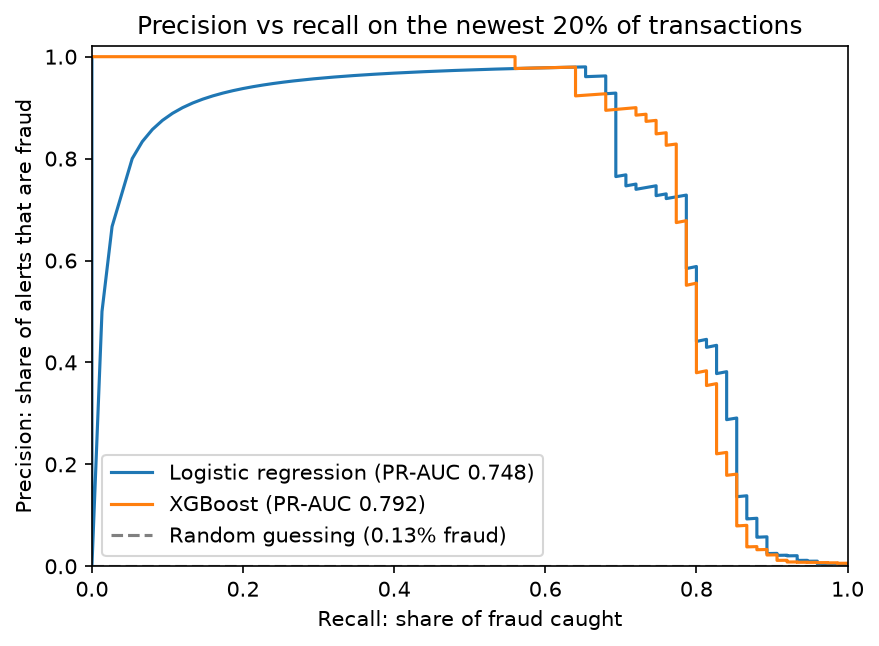
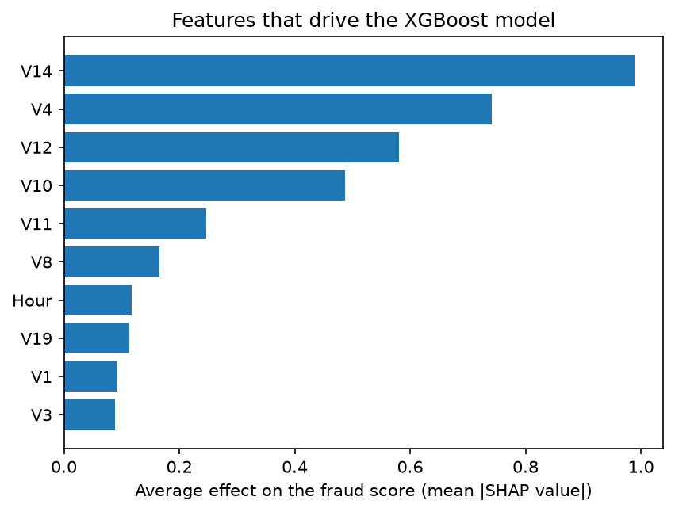

# Card fraud detection

Spotting fraudulent card payments in 284,807 real transactions from European cardholders, where only 492 (0.17%) are fraud.

The project compares a logistic regression baseline with XGBoost. It decides when to raise an alert by weighing the cost of missed fraud against the cost of reviewing alerts, and explains every score with SHAP values. The model is served through a small FastAPI web API, with tests and CI.

## What makes it more than a notebook

- **Tested the way a bank would use it.** The data is split by time: the model learns from the oldest 60% of transactions and is tested on the newest 20%. A random split would let it learn from the future and flatter the score.
- **Alerts tuned to money, not accuracy.** Flagging nothing is 99.8% accurate, so accuracy is useless here. The alert threshold minimises missed fraud plus a review cost per alert (5 by default; change it with `--review-cost`).
- **Every score comes with reasons.** XGBoost's built-in TreeSHAP shows which features pushed each transaction towards fraud.
- **Built like production code.** A FastAPI endpoint scores one transaction at a time. Pytest covers the pipeline and the API, GitHub Actions runs the tests on every push, and a Dockerfile packages the API.

## Results

<!-- After training on the real data, replace this comment with the contents of reports/results.md -->





## Run it

Needs Python 3.10 or newer.

```bash
python -m venv .venv
source .venv/bin/activate          # Windows: .venv\Scripts\activate
pip install -r requirements.txt

python -m fraud.train --openml     # downloads the data (around 150 MB) and trains both models
# or, with creditcard.csv from Kaggle saved in data/:
python -m fraud.train --data data/creditcard.csv

pytest                             # uses generated data, so it doesn't need the download
uvicorn fraud.api:app --reload     # then open http://127.0.0.1:8000/docs
```

Training writes results and charts to `reports/` and the model to `models/model.joblib`. To try everything on fake data first, run `python -m fraud.train --synthetic`.

### Docker

```bash
docker build -t fraud-api .
docker run -p 8000:8000 fraud-api
```

## How it works

| File | What it does |
|---|---|
| `fraud/data.py` | Loads the data and splits it by time |
| `fraud/features.py` | Logs the amount and turns raw time into hour of day |
| `fraud/models.py` | The logistic regression baseline and XGBoost |
| `fraud/evaluate.py` | Picks the cost-minimising alert threshold and measures results |
| `fraud/explain.py` | SHAP explanations from XGBoost |
| `fraud/train.py` | Runs everything and writes the reports |
| `fraud/api.py` | The web API |
| `tests/` | Tests for the pipeline and the API |

## Limitations

- V1 to V28 are anonymised features, so explanations name features like "V14" rather than real-world things like merchant or country.
- The data covers two days in September 2013, so it can't show how fraud patterns change over months.
- The review cost per alert is an assumption, not a real bank figure.

## Data

The Credit Card Fraud Detection dataset from the Machine Learning Group at ULB (Université Libre de Bruxelles), available on [Kaggle](https://www.kaggle.com/datasets/mlg-ulb/creditcardfraud) and [OpenML](https://www.openml.org/d/1597). See those pages for licence terms. The data isn't included in this repository.
